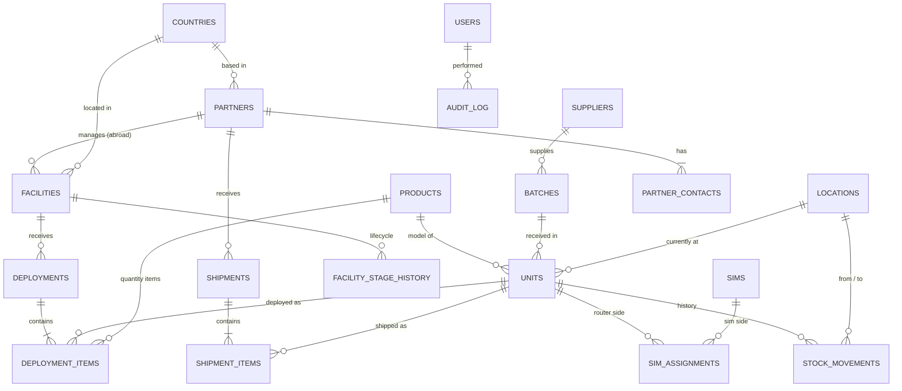

# Database design — v0.5 (conceptual model approved 2026-10-11; logical design in progress)

_Stage 4. Conceptual model only — no SQL yet. Built from the owner's answers on 2026-10-11._

v0.2: added partner companies abroad, partner contacts, shipments; IP stored per SIM assignment.
v0.3: any number of countries (`countries` table); abroad deployments tracked via partner stock;
non-configurable products skip "Configured".
v0.4: conceptual model approved; no return path from abroad (F10); SIMs become units (see §L1);
logical design part 1 (products, suppliers, batches, units).
v0.5: batch codes auto-generated from supplier prefix (Q1); logical design part 2 (locations, movements, stock levels).

## Business facts this model is built on

| # | Fact (owner, 2026-10-11) | Effect on the design |
|---|--------------------------|----------------------|
| F1 | All goods are received at **MRD Office** — one place, no shelves/bins | One office location; no bin-level tracking |
| F2 | Goods go from the office to **facilities**, or are **shipped abroad** (e.g. Saudi Arabia, Qatar) — any product, not only routers/SIMs | Destinations include facilities and foreign recipients |
| F3 | A Teltonika TRB router uses **one SIM at a time**; the SIM has an IP after configuration | SIM ↔ router is one-to-one *at a time*, with history |
| F4 | One deployment to a facility can contain **many products** | Deployment → many deployment items |
| F6 | Goods sent abroad go to a **partner company** in that country, which takes ownership. Each partner has a company name and **one or more contact people**. Countries also have **facilities** with deployments, POCs and contracts | `partners`, `partner_contacts`, `shipments`; facilities get a country and an optional partner |
| F7 | IP is assigned **at configuration**; a SIM change means reconfiguration and probably a new IP (owner not certain) | IP stored on the **SIM-in-router assignment**, not on the SIM or router alone — correct in either case |
| F8 | **Any number of countries**, not only Qatar/Saudi | `countries` reference table |
| F9 | MRD must track **all abroad deployments** — which items, how many, to which facility | Shipped items sit in the partner's stock until an abroad deployment is recorded |
| F10 | Items **never come back from abroad** | No return path from partner stock/abroad facilities in normal workflow; a Super Admin correction is the only exception |
| F11 | **Hybrid** products (e.g. CO₂ sensors) arrive as a counted quantity and get serials during preparation (from design) | Batch records the counted quantity; units are created when serials are assigned |
| F5 | Equipment can **come back** (POC not converted, fault) and go to **repair/servicing/reconfiguration** or **back to the supplier** under warranty, then possibly be redeployed | Units have a lifecycle and a full movement history |

Note: the design's sample data uses the RUT956 model; MRD's real router is the TRB series. Product
models are data rows, not part of the structure, so this changes nothing in the schema.

## Entity-relationship diagram (draft)



(GitHub renders this as a picture.)

## The tables in plain language

| Table | One row is… | Key rules |
|-------|-------------|-----------|
| `products` | A model or item type (TRB router, SIM, sensor, Cat6 cable) | Tracking type: **serialised** (one row per item in `units`) or **quantity** (counted) |
| `suppliers` | A company MRD buys from | Needed for warranty returns |
| `batches` | One delivery received at MRD Office | Belongs to one supplier |
| `units` | One physical serialised item | Unique serial; belongs to one product and one batch; has a current status and location |
| `sims` | One SIM card | Unique ICCID; holds its number and IP |
| `sim_assignments` | "This SIM was in this router from… to…, configured with IP …" | **Only one open assignment per router and per SIM**; an IP can't be on two open assignments |
| `locations` | A place goods can be: MRD Office, each facility, each partner's stock, repair/service, supplier | Single office; no shelves |
| `facilities` | A client site (Qatar Foundation, Lulu…) in any country | Has a country, a current stage, and optionally the partner that manages it |
| `countries` | One country (Oman, Qatar, Saudi Arabia, …) | Unique name/code; add new countries any time, no code change |
| `partners` | A partner company abroad (one or more per country) | Company name, country; has its own stock location |
| `partner_contacts` | One contact person at a partner | A partner has one or more |
| `shipments` | One consignment from MRD Office to a partner | Has many items; ownership passes to the partner |
| `shipment_items` | One line of a shipment: a unit, or a product + quantity | A unit can't be in two open shipments |
| `facility_stage_history` | "Facility moved to stage X on date Y by Z" | Insert-only |
| `deployments` | One dispatch to a facility (POC or contract) | Has many items |
| `deployment_items` | One line of a deployment: a unit, or a product + quantity | A unit can't be in two active deployments |
| `stock_movements` | Any move: received, deployed, returned, sent to repair, shipped abroad, back to supplier | **Insert-only — history is never edited or deleted** |
| `users`, `roles`, `permissions` | People and what they may do | Pending until approved |
| `audit_log` | Any change: who, what, when, before/after | Insert-only |

## Unit lifecycle (draft)

```
Received ─► In office ─┬─► Configured* ─┬─► Deployed (facility, any country)
               ▲       │                │
               │       │                └─► Shipped to partner ─► Partner stock ─► Deployed abroad
               │       └── (non-configurable products go straight to Deployed / Shipped)
               │
               ├── In repair / servicing ◄── fault (from office or a deployment)
               └── Returned to office  ◄──── POC not converted / removed from facility
In office / In repair ─► Returned to supplier (warranty) ─► replacement arrives as a new receipt
Any ─► Retired (written off)

* Configured applies to routers (SIM + IP); sensors, cables etc. skip it.
```

Control report this enables: **"Shipped to partner, not yet deployed"** — anything sitting in a
partner's stock too long is visible.

## Assumptions to confirm (do not block the design)

- **A1** (resolved → F9) Abroad deployments are tracked.
- **A3** (resolved → F10) Items do not come back from abroad.
- **A2** IP-per-assignment (F7): confirm with whoever configures the routers.

---

# Logical design (columns, types, rules)

## L0. Conventions used in every table

| Convention | Meaning | Why |
|------------|---------|-----|
| `id bigint` identity primary key | Internal number, assigned by the database, never changes | Stable links between tables |
| `created_at`, `updated_at timestamptz` | When the row was made / last changed, with time zone | Oman, Qatar, Saudi users see correct local times |
| `is_active boolean` instead of deleting | "Archived" rather than removed | Deleting a product would break the history of every unit that used it |
| Foreign keys use `ON DELETE RESTRICT` | The database refuses to delete a row others still point to | History can't be destroyed by accident |
| Status values are a fixed list (enum) | e.g. `in_office`, `configured`, `deployed` | A typo like `deplyed` is rejected |

## L1. Design change: SIMs are units

In v0.3 SIMs had their own table. But a SIM is received in a batch, sits in the office, moves to a
facility inside a router — exactly what `units` already tracks. Keeping them separate would mean
building receiving, movements and history twice. So: **a SIM is a unit of a SIM product**, and its
SIM-only fields (ICCID, phone number, carrier) live in a small side table `sim_details` linked
one-to-one. `sim_assignments` now links a SIM unit to a router unit.

## L2. Part 1 — products, suppliers, batches, units

### `categories`
| Column | Type | Rules |
|--------|------|-------|
| id | bigint | primary key |
| name | text | required, unique (Routers, SIM cards, Sensors, Cables & Accessories …) |
| is_active | boolean | default true |

### `products`
| Column | Type | Rules |
|--------|------|-------|
| id | bigint | primary key |
| name | text | required |
| brand | text | required (Teltonika …) |
| model | text | required (TRB…) ; **unique together with brand** |
| category_id | bigint | required → `categories` |
| tracking_type | enum | `serialised` · `quantity` · `hybrid` — required |
| requires_configuration | boolean | default false (true for routers) |
| min_stock_level | integer | required, default 0, **must be ≥ 0** |
| description | text | optional |
| specifications | jsonb | optional free-form key/values (varies per product) |
| is_active, created_at, updated_at | | conventions |

### `suppliers`
| Column | Type | Rules |
|--------|------|-------|
| id | bigint | primary key |
| name | text | required, unique |
| code_prefix | text | required, unique, 2–5 capital letters (e.g. `TEL`) — used for batch codes |
| country_id | bigint | → `countries` |
| email, phone | text | optional |
| is_active, created_at, updated_at | | conventions |

### `batches` — one delivery received at MRD Office
| Column | Type | Rules |
|--------|------|-------|
| id | bigint | primary key |
| code | text | required, unique (e.g. `TEL-2026-004`). **Generated automatically** as supplier prefix – year – next number for that prefix and year. Switching to manual entry later only changes the form; the unique rule stays |
| supplier_id | bigint | required → `suppliers` |
| purchase_order | text | optional |
| invoice_number | text | optional |
| received_on | date | required, not in the future |
| received_by | uuid | required → `users` |
| notes | text | optional |
| created_at | timestamptz | convention |

### `batch_lines` — what a delivery contained
| Column | Type | Rules |
|--------|------|-------|
| id | bigint | primary key |
| batch_id | bigint | required → `batches` |
| product_id | bigint | required → `products`; **one line per product per batch** |
| quantity_received | integer | required, **must be > 0** |

### `units` — one physical serialised item (routers, SIMs, serialised sensors)
| Column | Type | Rules |
|--------|------|-------|
| id | bigint | primary key |
| product_id | bigint | required → `products` (must be serialised or hybrid) |
| batch_line_id | bigint | required → `batch_lines` (where it came from) |
| serial_number | text | required; **unique per product** |
| imei | text | optional; unique when present |
| status | enum | required, default `in_office` (lifecycle values) |
| location_id | bigint | required → `locations` (where it is now) |
| created_at, updated_at | | conventions |

Rule enforced in a transaction, not a simple column check: units created for a batch line can never
exceed its `quantity_received`.

### `sim_details` — extra fields for SIM units (one-to-one)
| Column | Type | Rules |
|--------|------|-------|
| unit_id | bigint | primary key **and** → `units` (that's what makes it one-to-one) |
| iccid | text | required, unique |
| phone_number | text | optional, unique when present |
| carrier | text | optional |

## L3. Part 2 — locations, movements, stock levels

The bank-account model: a bank keeps **every transaction** (never edited) and a **balance**.
We do the same — `stock_movements` is the transaction list, `stock_levels` is the balance.

### `locations`
| Column | Type | Rules |
|--------|------|-------|
| id | bigint | primary key |
| type | enum | `office` · `facility` · `partner_stock` · `repair` · `supplier` — required |
| name | text | required (e.g. "MRD Office", "Lulu Hypermarket") |
| facility_id | bigint | → `facilities`; **required when type = facility**, otherwise empty |
| partner_id | bigint | → `partners`; **required when type = partner_stock**, otherwise empty |
| supplier_id | bigint | → `suppliers`; **required when type = supplier**, otherwise empty |

One location per facility, per partner and per supplier (unique). Exactly one `office` row.

### `stock_movements` — every move ever made (insert-only)
| Column | Type | Rules |
|--------|------|-------|
| id | bigint | primary key |
| movement_type | enum | `receive` · `serialise` · `deploy` · `ship` · `deploy_abroad` · `return` · `send_repair` · `back_from_repair` · `return_to_supplier` · `write_off` · `correction` |
| product_id | bigint | required → `products` |
| unit_id | bigint | → `units`; set for serialised items, empty for quantity items |
| quantity | integer | required, **> 0**; **must be 1 when unit_id is set** |
| from_location_id | bigint | → `locations`; empty only for `receive` |
| to_location_id | bigint | → `locations`; empty only for `write_off`; **must differ from from_location** |
| batch_id / deployment_id / shipment_id | bigint | the document that caused the move (whichever applies) |
| performed_by | uuid | required → `users` |
| moved_at | timestamptz | required, default now |
| note | text | optional |

- **No updates, no deletes** — enforced by database permissions, not just app code. A mistake is
  fixed by a new `correction` movement, like a reversing entry in accounting.
- `deploy_abroad` may only start from a `partner_stock` location (F9); nothing may move *out of*
  an abroad facility or partner stock except by a Super Admin `correction` (F10).

### `stock_levels` — current balance for counted (quantity / un-serialised hybrid) items
| Column | Type | Rules |
|--------|------|-------|
| location_id | bigint | → `locations` |
| product_id | bigint | → `products` |
| quantity | integer | required, **CHECK quantity ≥ 0 — this is the "no negative stock" guarantee** |
| | | **Primary key = (location_id, product_id)** — one balance row per product per place |

Serialised units don't need a balance row: each unit's `location_id` *is* its position, and
counts are calculated from `units`.

### How one operation stays consistent (transaction)

Deploying 6 cables from the office to Lulu runs as **one transaction**:

```
BEGIN
  1. office balance  : 10 → 4     (row is locked while we change it)
  2. Lulu balance    :  0 → 6
  3. insert stock_movement (deploy, 6, office → Lulu)
  4. insert audit record
COMMIT   ← all four happen, or none do
```

If step 1 would make the office balance negative, the CHECK rule fails, the database undoes
steps 1–4, and the user sees "Only 4 in stock".

Next parts: facilities, partners & deployments (L4), users, roles &
audit (L5).
