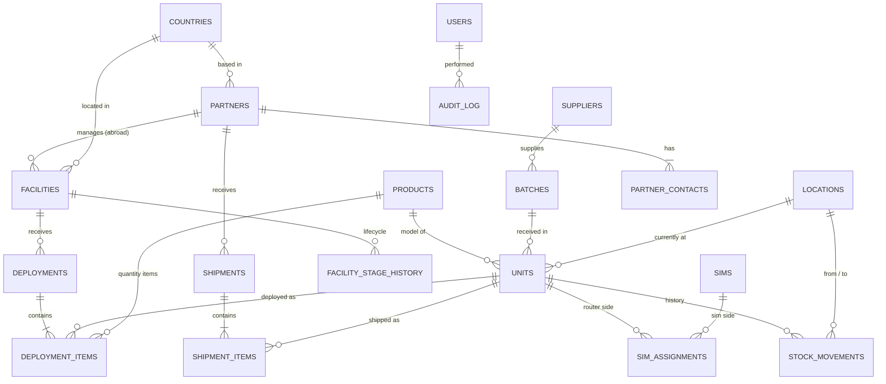

# Database design — DRAFT v0.3 (not approved)

_Stage 4. Conceptual model only — no SQL yet. Built from the owner's answers on 2026-10-11._

v0.2: added partner companies abroad, partner contacts, shipments; IP stored per SIM assignment.
v0.3: any number of countries (`countries` table); abroad deployments tracked via partner stock;
non-configurable products skip "Configured".

## Business facts this model is built on

| # | Fact (owner, 2026-10-11) | Effect on the design |
|---|--------------------------|----------------------|
| F1 | All goods are received at **MRD Office** — one place, no shelves/bins | One office location; no bin-level tracking |
| F2 | Goods go from the office to **facilities**, or are **shipped abroad** (e.g. Saudi Arabia, Qatar) — any product, not only routers/SIMs | Destinations include facilities and foreign recipients |
| F3 | A Teltonika TRB router uses **one SIM at a time**; the SIM has an IP after configuration | SIM ↔ router is one-to-one *at a time*, with history |
| F4 | One deployment to a facility can contain **many products** | Deployment → many deployment items |
| F6 | Goods sent abroad go to a **partner company** in that country, which takes ownership. Each partner has a company name and **one or more contact people**. Countries also have **facilities** with deployments, POCs and contracts | `partners`, `partner_contacts`, `shipments`; facilities get a country and an optional partner |
| F7 | IP is assigned **at configuration**; a SIM change means reconfiguration and probably a new IP (owner not certain) | IP stored on the **SIM-in-router assignment**, not on the SIM or router alone — correct in either case |
| F8 | **Any number of countries**, not only Qatar/Saudi | `countries` reference table |
| F9 | MRD must track **all abroad deployments** — which items, how many, to which facility | Shipped items sit in the partner's stock until an abroad deployment is recorded |
| F5 | Equipment can **come back** (POC not converted, fault) and go to **repair/servicing/reconfiguration** or **back to the supplier** under warranty, then possibly be redeployed | Units have a lifecycle and a full movement history |

Note: the design's sample data uses the RUT956 model; MRD's real router is the TRB series. Product
models are data rows, not part of the structure, so this changes nothing in the schema.

## Entity-relationship diagram (draft)



(GitHub renders this as a picture.)

## The tables in plain language

| Table | One row is… | Key rules |
|-------|-------------|-----------|
| `products` | A model or item type (TRB router, SIM, sensor, Cat6 cable) | Tracking type: **serialised** (one row per item in `units`) or **quantity** (counted) |
| `suppliers` | A company MRD buys from | Needed for warranty returns |
| `batches` | One delivery received at MRD Office | Belongs to one supplier |
| `units` | One physical serialised item | Unique serial; belongs to one product and one batch; has a current status and location |
| `sims` | One SIM card | Unique ICCID; holds its number and IP |
| `sim_assignments` | "This SIM was in this router from… to…, configured with IP …" | **Only one open assignment per router and per SIM**; an IP can't be on two open assignments |
| `locations` | A place goods can be: MRD Office, each facility, each partner's stock, repair/service, supplier | Single office; no shelves |
| `facilities` | A client site (Qatar Foundation, Lulu…) in any country | Has a country, a current stage, and optionally the partner that manages it |
| `countries` | One country (Oman, Qatar, Saudi Arabia, …) | Unique name/code; add new countries any time, no code change |
| `partners` | A partner company abroad (one or more per country) | Company name, country; has its own stock location |
| `partner_contacts` | One contact person at a partner | A partner has one or more |
| `shipments` | One consignment from MRD Office to a partner | Has many items; ownership passes to the partner |
| `shipment_items` | One line of a shipment: a unit, or a product + quantity | A unit can't be in two open shipments |
| `facility_stage_history` | "Facility moved to stage X on date Y by Z" | Insert-only |
| `deployments` | One dispatch to a facility (POC or contract) | Has many items |
| `deployment_items` | One line of a deployment: a unit, or a product + quantity | A unit can't be in two active deployments |
| `stock_movements` | Any move: received, deployed, returned, sent to repair, shipped abroad, back to supplier | **Insert-only — history is never edited or deleted** |
| `users`, `roles`, `permissions` | People and what they may do | Pending until approved |
| `audit_log` | Any change: who, what, when, before/after | Insert-only |

## Unit lifecycle (draft)

```
Received ─► In office ─┬─► Configured* ─┬─► Deployed (facility, any country)
               ▲       │                │
               │       │                └─► Shipped to partner ─► Partner stock ─► Deployed abroad
               │       └── (non-configurable products go straight to Deployed / Shipped)
               │
               ├── In repair / servicing ◄── fault (from office or a deployment)
               └── Returned to office  ◄──── POC not converted / removed from facility
In office / In repair ─► Returned to supplier (warranty) ─► replacement arrives as a new receipt
Any ─► Retired (written off)

* Configured applies to routers (SIM + IP); sensors, cables etc. skip it.
```

Control report this enables: **"Shipped to partner, not yet deployed"** — anything sitting in a
partner's stock too long is visible.

## Assumptions to confirm (do not block the design)

- **A1** (resolved → F9) Abroad deployments are tracked.
- **A3** Can items come back from abroad (repair, warranty, unused)? Model allows it if yes.
- **A2** IP-per-assignment (F7): confirm with whoever configures the routers.
