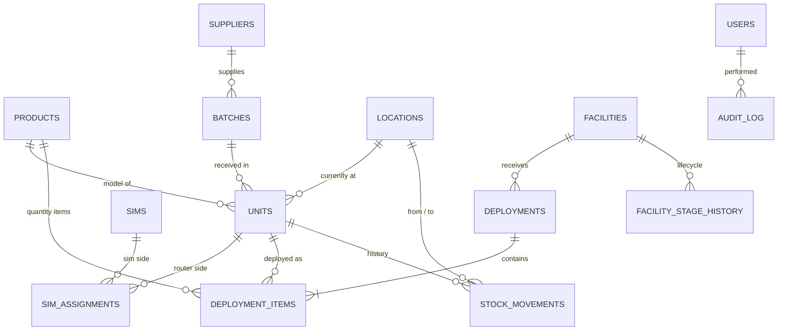

# Database design — DRAFT v0.1 (not approved)

_Stage 4. Conceptual model only — no SQL yet. Built from the owner's answers on 2026-10-11._

## Business facts this model is built on

| # | Fact (owner, 2026-10-11) | Effect on the design |
|---|--------------------------|----------------------|
| F1 | All goods are received at **MRD Office** — one place, no shelves/bins | One office location; no bin-level tracking |
| F2 | Goods go from the office to **facilities**, or are **shipped abroad** (e.g. Saudi Arabia, Qatar) — any product, not only routers/SIMs | Destinations include facilities and foreign recipients |
| F3 | A Teltonika TRB router uses **one SIM at a time**; the SIM has an IP after configuration | SIM ↔ router is one-to-one *at a time*, with history |
| F4 | One deployment to a facility can contain **many products** | Deployment → many deployment items |
| F5 | Equipment can **come back** (POC not converted, fault) and go to **repair/servicing/reconfiguration** or **back to the supplier** under warranty, then possibly be redeployed | Units have a lifecycle and a full movement history |

Note: the design's sample data uses the RUT956 model; MRD's real router is the TRB series. Product
models are data rows, not part of the structure, so this changes nothing in the schema.

## Entity-relationship diagram (draft)



(GitHub renders this as a picture.)

## The tables in plain language

| Table | One row is… | Key rules |
|-------|-------------|-----------|
| `products` | A model or item type (TRB router, SIM, sensor, Cat6 cable) | Tracking type: **serialised** (one row per item in `units`) or **quantity** (counted) |
| `suppliers` | A company MRD buys from | Needed for warranty returns |
| `batches` | One delivery received at MRD Office | Belongs to one supplier |
| `units` | One physical serialised item | Unique serial; belongs to one product and one batch; has a current status and location |
| `sims` | One SIM card | Unique ICCID; holds its number and IP |
| `sim_assignments` | "This SIM was in this router from… to…" | **Only one open assignment per router and per SIM** |
| `locations` | A place goods can be: MRD Office, each facility, a foreign destination, repair/service, supplier | Single office; no shelves |
| `facilities` | A client site (Qatar Foundation, Lulu…) | Has a current stage |
| `facility_stage_history` | "Facility moved to stage X on date Y by Z" | Insert-only |
| `deployments` | One dispatch to a facility (POC or contract) | Has many items |
| `deployment_items` | One line of a deployment: a unit, or a product + quantity | A unit can't be in two active deployments |
| `stock_movements` | Any move: received, deployed, returned, sent to repair, shipped abroad, back to supplier | **Insert-only — history is never edited or deleted** |
| `users`, `roles`, `permissions` | People and what they may do | Pending until approved |
| `audit_log` | Any change: who, what, when, before/after | Insert-only |

## Unit lifecycle (draft)

```
Received ─► In office ─► Configured ─► Deployed (facility)
               ▲   │          │              │
               │   │          └─► Shipped abroad
               │   ▼                         │
               ├── In repair / servicing ◄───┤  (fault)
               │                             │
               └──────── Returned ◄──────────┘  (POC not converted)
In office / In repair ─► Returned to supplier (warranty) ─► (replacement arrives as new receipt)
Any ─► Retired (written off)
```

## Open questions (affect the schema)

- **R4** Shipments abroad: is the recipient a facility MRD manages (tracked like local facilities),
  or a partner/company that takes ownership? Do items ever come back from abroad?
- **R5** IP address: does the IP belong to the **SIM** (stays with the SIM if moved to another
  router) or to the **router configuration**?
